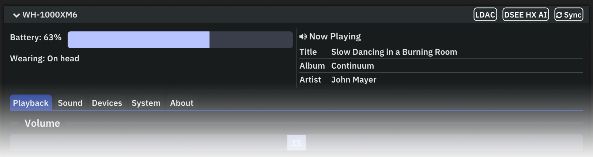

# SonyHeadphonesClient

A spiritual successor to [Plutoberth's original SonyHeadphonesClient](https://github.com/Plutoberth/SonyHeadphonesClient) - now with standardized support for newer devices and more platforms.

There's no [Release](https://github.com/mos9527/SonyHeadphonesClient/releases) build for this branch yet - but you can always grab the latest [nightly builds](https://nightly.link/mos9527/SonyHeadphonesClient/workflows/cmake/v1-compat?preview), or use the [Web Version](#running-on-the-web).

[](https://github.com/mos9527/SonyHeadphonesClient/actions/workflows/cmake.yml)
[](https://nightly.link/mos9527/SonyHeadphonesClient/workflows/cmake/v1-compat?preview)



## Roadmap

This branch is expected to be merged/released once general support for *all* legacy (`v1` protocol) devices is reached.

These legacy devices are currently being verified against:

- [x] [WH-1000XM2 (support matrix pending)](https://github.com/mos9527/SonyHeadphonesClient/issues/61)
- [x] [WH-1000XM3](./docs/device-support/WH-1000XM3.md)
- [x] WH-1000XM4 (tested by [@Amrsatrio](https://github.com/Amrsatrio))

Track the progress in [Support for V1/Legacy devices such as XM3s and XM4s - PR #56](https://github.com/mos9527/SonyHeadphonesClient/pull/56).

Feel free to submit support status in new Issues regarding v1 (XM4 and older) devices. We *really* need more volunteers :(

## Platform Support

**NOTE:** These apply to [`libmdr-bt`](./libmdr-bt/) (the Bluetooth platform backend) and [`client`](./client/) (the UI). For [`libmdr`](./libmdr/), the protocol library *itself* is platform agnostic.

The architectures (x64, etc) shown here are the ones built by GitHub Actions, and are available in [nightly builds](https://nightly.link/mos9527/SonyHeadphonesClient/workflows/cmake/v1-compat?preview).

| Platform         | Support Status | Maintainers |
|------------------|----------------|----------------------|
| Windows (`x86/x64/ARM64`, [Windows XP SP2](#running-compatibility-builds) and up) | Full Support | [@mos9527](https://github.com/mos9527), [@Amrsatrio](https://github.com/Amrsatrio) |
| Linux  (`x86/x64/ARMv7/ARM64`)| Full Support | [@mos9527](https://github.com/mos9527) |
| macOS   (Universal) | Full Support | [@mos9527](https://github.com/mos9527) |
| iOS (`ARM64`, [15.0+](https://github.com/mos9527/SonyHeadphonesClient/pull/70)) | Full Support, [manual build/install required](./DEVELOPER.md#ios-xcode) | [@mos9527](https://github.com/mos9527) |
| Android (`ARMv7/ARM64`, [5.0+](https://github.com/mos9527/SonyHeadphonesClient/pull/69)) | Supported, `client` only | [@mos9527](https://github.com/mos9527) |
| Web (`WASM32`, Emscripten) | Full Support | [@mos9527](https://github.com/mos9527) |
| HarmonyOS (`ARM64`, [OpenHarmony](https://github.com/mos9527/SonyHeadphonesClient/pull/68)) | Supported, `client` only, [manual build required](./DEVELOPER.md#openharmony-deveco-studio) | [@mos9527](https://github.com/mos9527) |

For device support, refer to [`docs/device-support`](./docs/device-support/). If the feature support status for your own device is missing/incorrect/untested there, feel free to submit an [Issue](https://github.com/mos9527/SonyHeadphonesClient/issues/new) so we can work on it!

## Running on the Web

Besides the broad [native platform support](#platform-support), the client is also available as a Progressive Web App (PWA) with full UI/feature parity with other platforms.

**Live version is available** at: <https://mos9527.com/SonyHeadphonesClient/>

A browser with [Web Serial](https://caniuse.com/web-serial) support for Bluetooth RFCOMM services is required. You can expect the app to work on:

- [Desktop Chrome (117+)](https://developer.chrome.com/blog/serial-over-bluetooth), and Chromium derivatives (e.g. Edge, Opera)
- [Android Chrome (148+)](https://chromestatus.com/feature/6043992171085824)

### Running on Firefox

**Firefox is unsupported by default:** Although [Firefox 151+ supports Web Serial](https://hacks.mozilla.org/2026/05/web-serial-support-in-firefox/), it only exposes serial ports already created by the operating system (e.g. COM ports on Windows) and does not open Bluetooth RFCOMM connections itself. Some workarounds are available, however:

- On Windows, with the headphones paired, run [`tooling/scripts/bluetoothcom-win32.py`](tooling/scripts/bluetoothcom-win32.py) from an Administrator prompt. For example with the XM6:

  ```powershell
  # usage: python tooling/scripts/bluetoothcom-win32.py --help
  python tooling/scripts/bluetoothcom-win32.py bind "WH-1000XM6"
  ```

  This installs Windows' built-in `Standard Serial over Bluetooth link` driver for the headphones' RFCOMM interface, and a COM port will be created afterwards.

**NOTE:** The workarounds may apply to other browsers with WebSerial support only as well.

## Running Compatibility Builds

Compatibility builds are offered for certain platforms, where limited sets of features are made available to make it run there. These builds are suffixed with `-compatibility`, and are available in [nightly](https://nightly.link/mos9527/SonyHeadphonesClient/workflows/cmake/v1-compat?preview) and [Releases (TBD)](https://github.com/mos9527/SonyHeadphonesClient/releases).

Currently, the following compatibility builds are available.

### Windows Compatibility Builds

Available as `SonyHeadphonesClient-win-x64-compatibility.exe` and `SonyHeadphonesClient-win-x86-compatibility.exe` in the CI. See [SHC Developer's Guide](./DEVELOPER.md#windows) for build flags.

These builds lower the minimal required Windows version from Windows 8.1 in the regular builds to Windows XP SP2.

- This build has no Bluetooth LE support, which is only introduced in [Windows 8.1 and above](https://learn.microsoft.com/en-us/windows-hardware/drivers/bluetooth/bluetooth-support-in-previous-windows-versions).  
- Threading is disabled in this build, see [e636d54](https://github.com/mos9527/SonyHeadphonesClient/commit/e636d54f039e85d9d915b0dc050968ffc18e25b6).
- [YY-Thunks](https://github.com/Chuyu-Team/YY-Thunks) is used to provide compatibility for Windows XP. Otherwise this would've been limited for Windows 7 and above.

## Fonts & Localization

The Client app uses your system's locale settings to select its application locale (`AppLocale`) and the default font your OS provides.

Locale can be overridden by using `--locale <locale>`.

- For the Web version, this can be manually specified in the URL via `...?locale=jp`, e.g. `https://mos9527.com/SonyHeadphonesClient/?locale=jp`.

The following locales are supported:

| Locale | Language | Localizer |
| ------ | -------- | --------- |
| default | Default (English) | - |
| en | Default (English) | - |
| sc | 简体中文/Simplified Chinese | [@mos9527](https://github.com/mos9527) |
| tc | 繁体中文/Traditional Chinese | [@mos9527](https://github.com/mos9527) |
| jp | 日本語/Japanese | TBD |
| kr | 한국어/Korean | TBD |

Additionally, for the Desktop (non-Web) client, `--font <file-path>` optionally loads an external font instead of the default font selected for the locale.

- Running `./SonyHeadphonesClient.exe --locale jp --font NotoSansCJKjp-Regular.otf` selects the Japanese application locale and the specified Noto Sans font.

## For Developers

See the [SHC Developer's Guide](./DEVELOPER.md) for [building instructions](./DEVELOPER.md#building) and development details.

See also [Contributing](./.github/CONTRIBUTING.md) for basic guidelines.

Extensive documentation is also available in the source files. Refer to the respective README files in each source folder to understand what they do!

## Platform Quirks

### Linux

On Linux, you may not see player metadata (track title, artist, etc.) despite correct output from the `playerctl metadata` command,
while your device has proper AVRCP support (e.g. it works on other platforms).

This mostly occurs with multipoint setups, and is mostly an implementation problem.

- You (or your distro) may have a misconfigured [MPRIS](https://wiki.archlinux.org/title/MPRIS) service. One way to remedy this
  is to manually run `mpris-proxy` (available in the `bluez-tools`/`bluez-utils` package) in the background, or as a systemd service.
- See also
  - <https://wiki.archlinux.org/title/MPRIS>
  - <https://github.com/bluez/bluez/issues/868>
  - [#65](https://github.com/mos9527/SonyHeadphonesClient/pull/65)
- Alternatively, the Linux Client App can be used as a fallback. This was introduced in [#63](https://github.com/mos9527/SonyHeadphonesClient/pull/63), where the wearing status of the device is used to control the host player status, thus bypassing AVRCP controls.
- This is disabled by default. You can enable it via the `--pause-media-on-remove` flag when launching the Client App. Thanks [@phedoreanu](https://github.com/phedoreanu) for the implementation!


## See also

- [libmdr-py - offical Python bindings](https://github.com/mos9527/libmdr-py) for `libmdr` and `libmdr-bt`, also providing a dedicated **command-line interface (CLI)**.
- [Lauscher - a Sailfish OS app for Sony Headphones using libmdr](https://github.com/Wunderfitz/harbour-lauscher) by [@Wunderfitz](https://github.com/Wunderfitz)
- Feel free to promote yours in [the Discussion page](https://github.com/mos9527/SonyHeadphonesClient/discussions/79)!

---

*This is a personal project, and is not officially endorsed by Sony Corporation in any capacity.*
