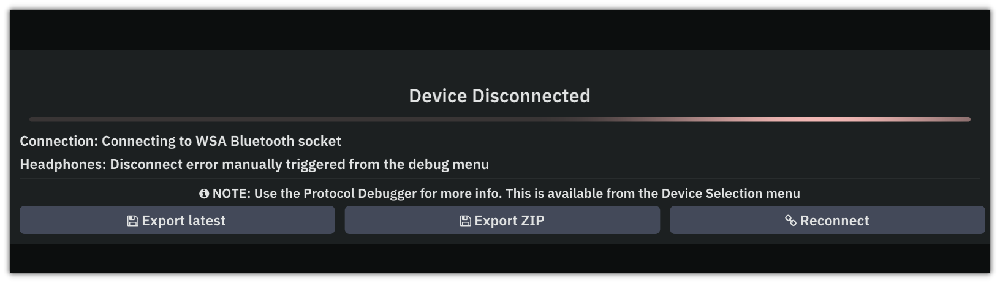
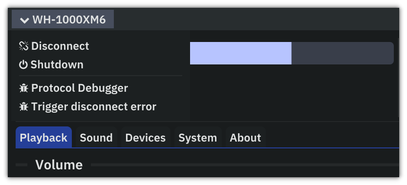
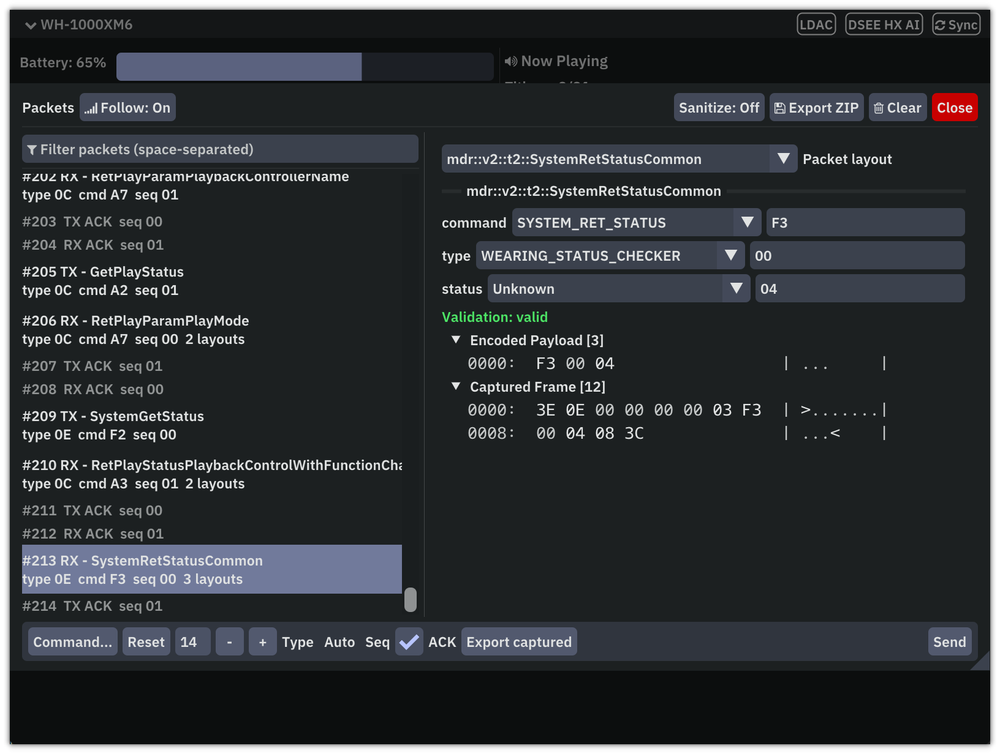
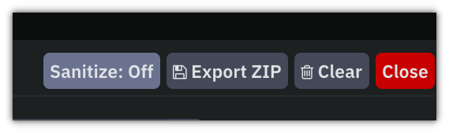

# Packet Capture and Test Contribution Guide

On-device packet captures for tests are always welcome. This guide also provides instructions for debugging malformed packets, which usually implies a bug in our protocol implementation (and you should report it too!).

## Capture with the Protocol Debugger

When the client includes the **Protocol Debugger** (official release builds, Debug builds, or builds configured with `-DMDR_CLIENT_DEBUGGER=ON`), you can replay a capture without connecting to headphones.

Drag and drop a capture folder or packet `.bin` file onto the client's viewport to replay it immediately. This works at any time in both the desktop and web clients.



When the device is disconnected with an error, the **Device Disconnected** dialog lets you export either the latest
packet (**Export latest**) or the session (**Export ZIP**). To capture on demand, exercise the features you're
interested in, then select **Trigger disconnect error** in the top-left drop-down menu.



You can also export from the **Protocol Debugger** window (same drop-down menu) at any time. The whole session is
kept from the moment the device connects, so exports always include the connection handshake the replay tests start
from. **Clear** in the debugger window discards it.



## Sanitizing Personal Data

The debugger **automatically removes sensitive personal data when exporting**, both for individual
packets and session ZIPs. The following are replaced with placeholders:

- Bluetooth MAC addresses, including the headphones' own address.
- Paired-device names.
- Now-playing text, including track, album, artist, genre and player names.

This can be opted out by exporting in the **Protocol Debugger** window, with the **Sanitize** option toggled OFF.



## Replay Tests and CI

The `mdr_replay_tests` CMake target is automatically run, for all the packets contributed to the repository in [`tests/`](../tests/) folder, in the CI.

This simulates full device connection sessions while validating the protocol implementation, feature handling and more with every commit to avoid regressions.

The utility takes a folder. So if you're exporting it from the **Protocol Debugger** window, where it's zipped, unzip it first.

```bash
mdr_replay_tests <capture-folder>
```

## Submitting the data

- Create an immediate subdirectory in the source tree named `<model>-<firmware version>` under
   `tests/`, for example `tests/WF-1000XM5-6.1.0/`
- You can find the FW version to your device under the **About** tab
- Testing locally is encouraged though not necessary, as successful application runs imply validated packets.
- To validate captures locally, build the aggregate `mdr_tests` target and run
  `mdr_replay_tests <packet-directory>`. Or you can push and have the CI check it for you.
- Commit and make your PR.
